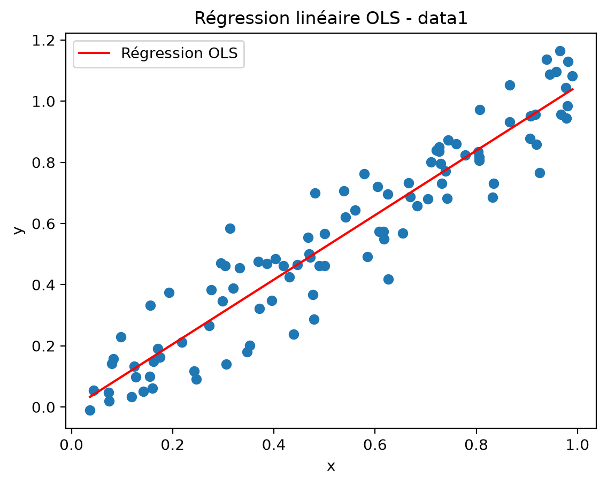
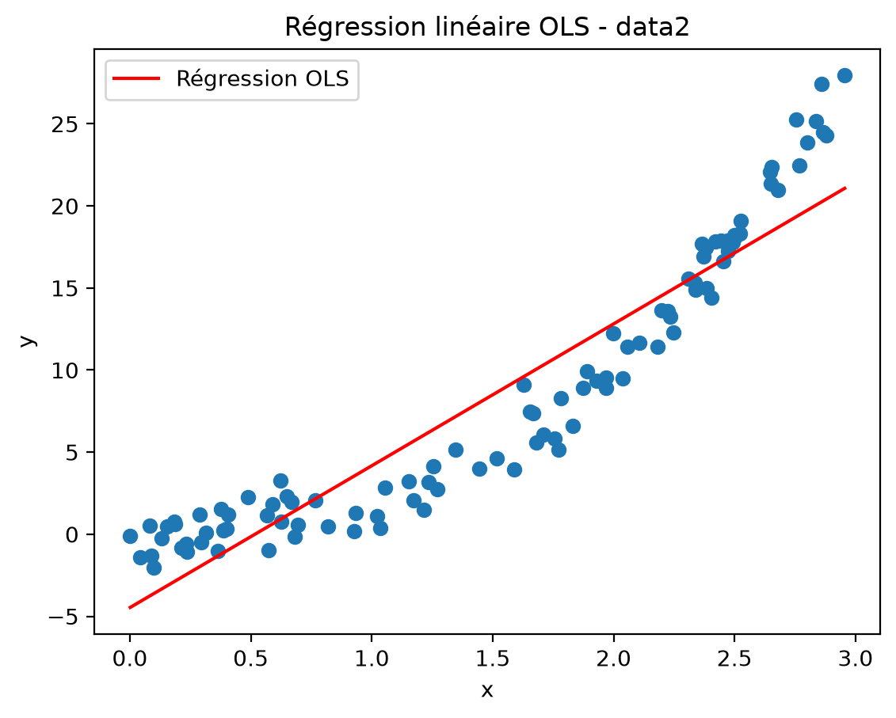
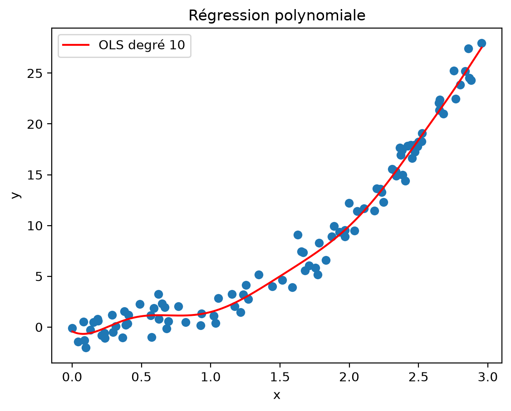
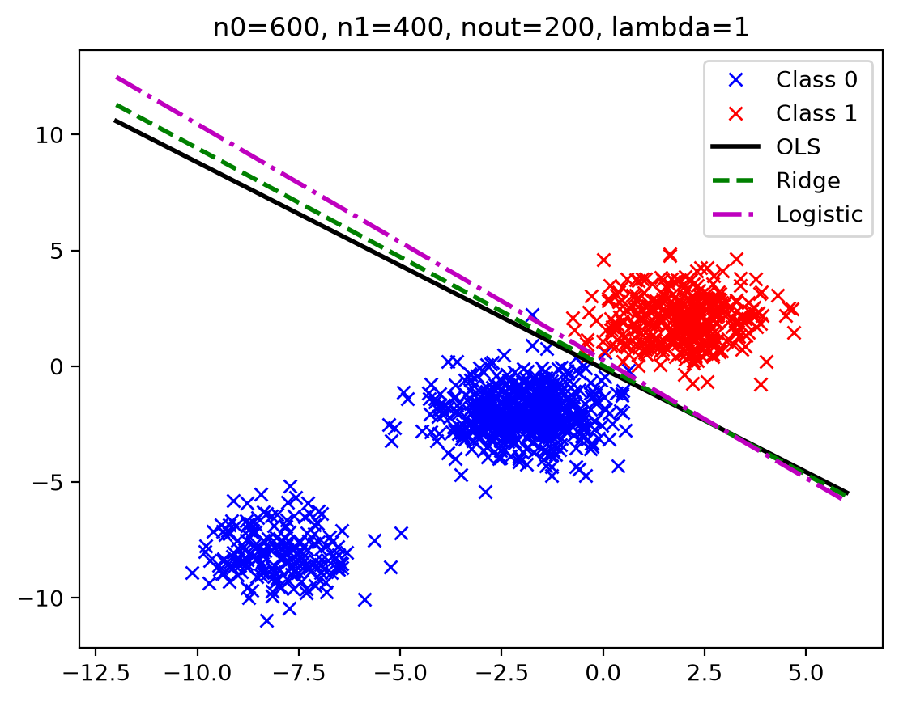
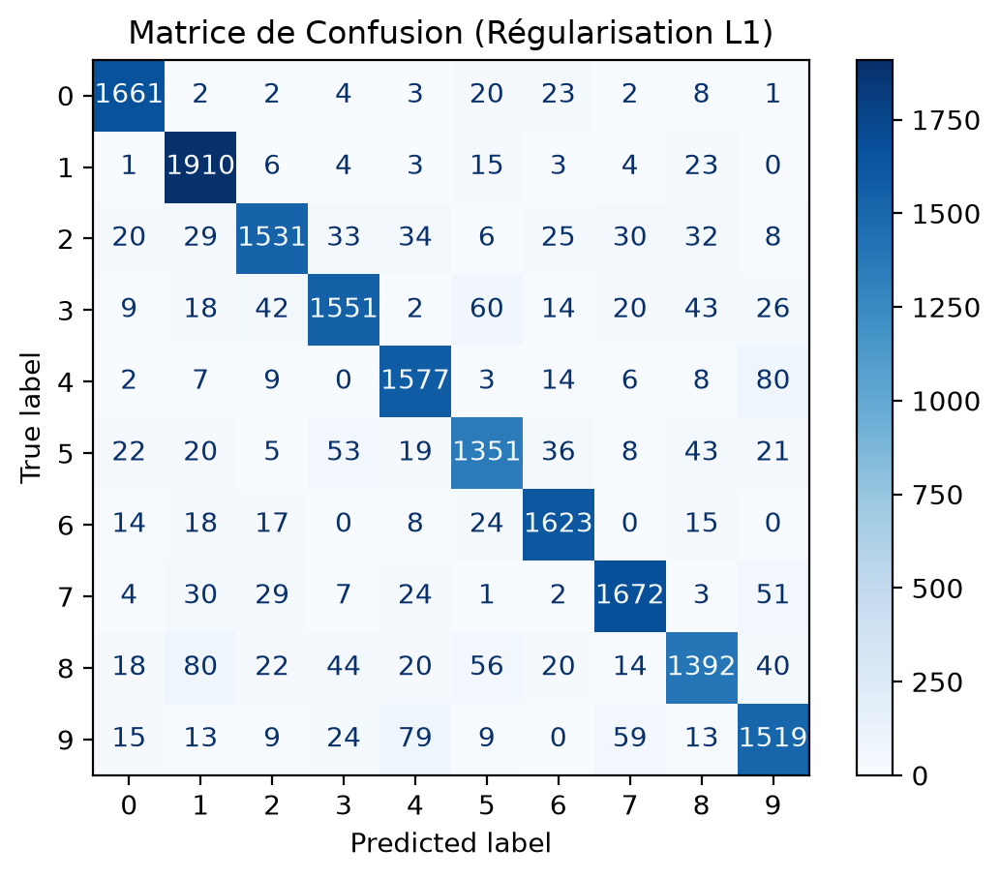
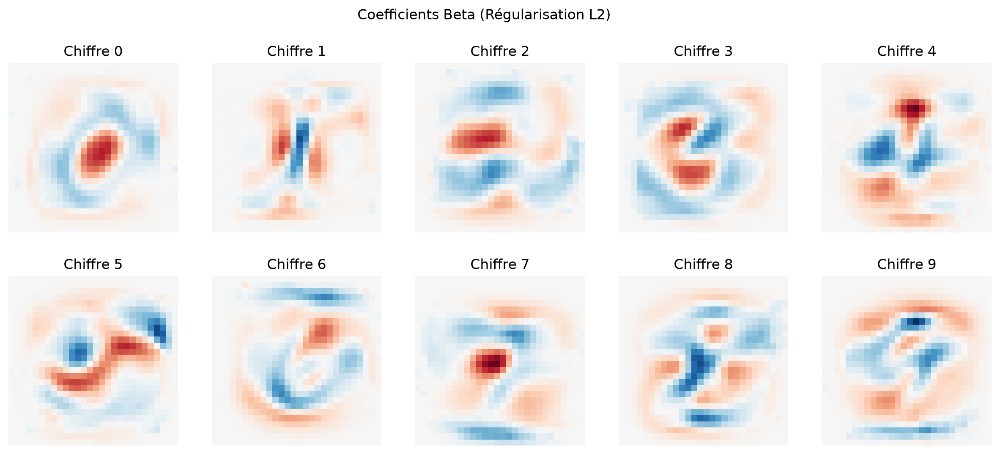
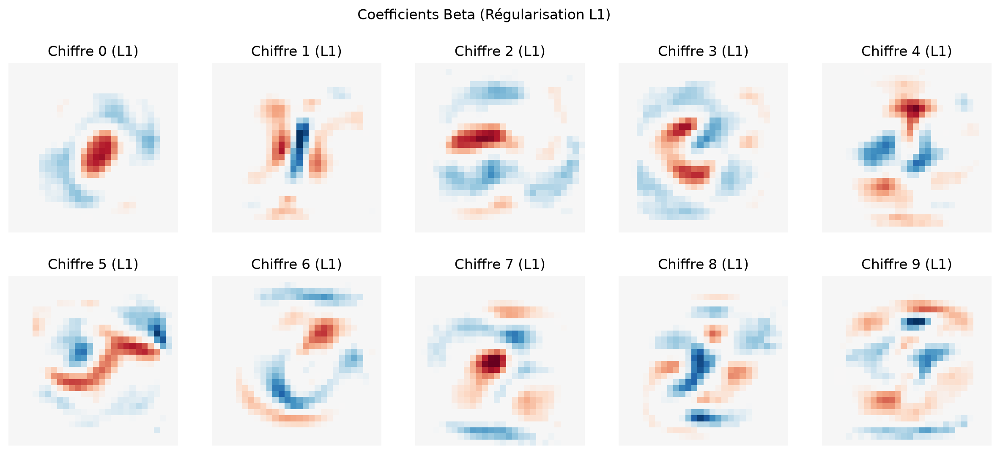

# Régression et classification en Machine Learning

Projet réalisé dans le cadre d'un travail de statistiques et de machine learning. Il regroupe des expériences de régression sur des données synthétiques, une comparaison de classifieurs et une étude de la régularisation sur MNIST.

## Régression linéaire et polynomiale

Le script `Parties_1_2.py` utilise deux jeux de données (`data/data1.npy` et `data/data2.npy`). Il ajuste des modèles par moindres carrés ordinaires (OLS), puis une régression polynomiale de degré 10 sur le second jeu.

Les erreurs affichées correspondent aux données d'apprentissage, pas à un jeu de test indépendant. Le script calcule aussi le conditionnement de la matrice polynomiale, afin d'examiner sa sensibilité numérique.

| OLS sur data1 | OLS sur data2 |
| :---: | :---: |
|  |  |



## Classification sur données synthétiques

Dans `Part3_Class_Regre_Logis_contre_Ridge_OLS.py`, les frontières de décision de trois méthodes sont comparées : OLS, Ridge et régression logistique.

Les données sont générées à partir de deux classes gaussiennes. Des observations aberrantes sont ajoutées à la classe 0 pour voir comment les frontières se déplacent. Le tirage n'est pas fixé : la figure peut donc varier d'une exécution à l'autre.



## Classification de chiffres manuscrits : MNIST

Le script `mnist.py` entraîne deux régressions logistiques multiclasses sur MNIST, l'une avec régularisation L1 et l'autre avec L2. La standardisation est ajustée sur l'ensemble d'entraînement uniquement.

Les matrices de confusion permettent de repérer les chiffres les plus souvent confondus.

| Régularisation L2 | Régularisation L1 |
| :---: | :---: |
|  |  |

Les coefficients de chaque classe sont également représentés comme des images de 28 × 28 pixels.

| Coefficients L2 | Coefficients L1 |
| :---: | :---: |
|  |  |

Les deux régularisations sont comparées avec l'accuracy et le F1-score macro. Le script affiche aussi le nombre de coefficients non nuls du modèle L1.

## Benchmark MNIST : effet de la PCA

Le script `mnist_benchmark.py` compare sept configurations : régression logistique, SVM linéaire, SVM à noyau RBF et k-NN, avec ou sans PCA selon le modèle.

Le benchmark utilise **12 000 images d'entraînement et 3 000 images de test**, issues d'une séparation stratifiée. Les hyperparamètres sont choisis par validation croisée stratifiée à trois plis, avec le **F1-score macro**. La standardisation et la PCA font partie des pipelines, ce qui évite de les ajuster sur les plis de validation.

### Résultats d'une exécution du benchmark

| Modèle | F1 macro (CV) | Accuracy test | F1 macro test | Variables | Recherche + CV (s) |
| --- | ---: | ---: | ---: | ---: | ---: |
| Régression logistique | 0,9050 | 91,17 % | 0,9100 | 784 | 2,4 |
| SVM linéaire | 0,8902 | 89,87 % | 0,8966 | 784 | 363,6 |
| SVM RBF | 0,9460 | 95,50 % | 0,9548 | 784 | 49,8 |
| k-NN | 0,9095 | 91,43 % | 0,9135 | 784 | 2,6 |
| PCA + SVM linéaire | 0,8995 | 90,73 % | 0,9058 | 289 | 148,9 |
| **PCA + SVM RBF** | **0,9486** | **95,83 %** | **0,9581** | **289** | **14,5** |
| PCA + k-NN | 0,9143 | 92,00 % | 0,9190 | 289 | 0,8 |

Dans cette exécution, la PCA conserve **95 % de la variance** avec 289 composantes au lieu de 784 variables, soit une réduction d'environ **63 %**.

Le meilleur score sur le test est obtenu avec **PCA + SVM RBF** : 95,83 % d'accuracy et 0,9581 de F1-score macro. Pour le SVM RBF, le temps de recherche et de validation croisée passe de 49,8 s à 14,5 s.

Ces chiffres proviennent d'une exécution donnée. Les temps dépendent de la machine et des versions des bibliothèques. Les petits écarts de score ne permettent pas, à eux seuls, de conclure à une amélioration systématique.

Le script enregistre le tableau complet, avec les temps de prédiction et les meilleurs hyperparamètres, dans `mnist_benchmark_results.csv`.

## Installation

Python et les dépendances indiquées dans `requirements.txt` sont nécessaires.

```bash
python -m venv .venv
source .venv/bin/activate
pip install -r requirements.txt
```

## Exécution

Depuis la racine du projet :

```bash
python Parties_1_2.py
python Part3_Class_Regre_Logis_contre_Ridge_OLS.py
python mnist.py
python mnist_benchmark.py
```

MNIST est téléchargé automatiquement au premier lancement. Les graphiques sont affichés et enregistrés en PNG dans `figures/`. Les scripts utilisant MNIST peuvent prendre plusieurs minutes, notamment le benchmark.

## Outils

Python, NumPy, pandas, Matplotlib, SciPy et scikit-learn.
